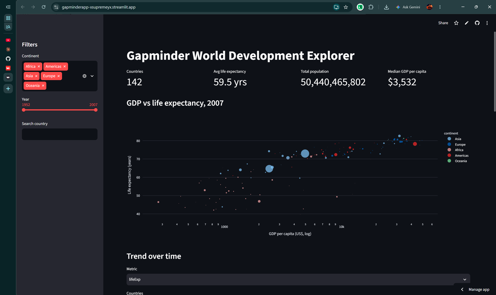
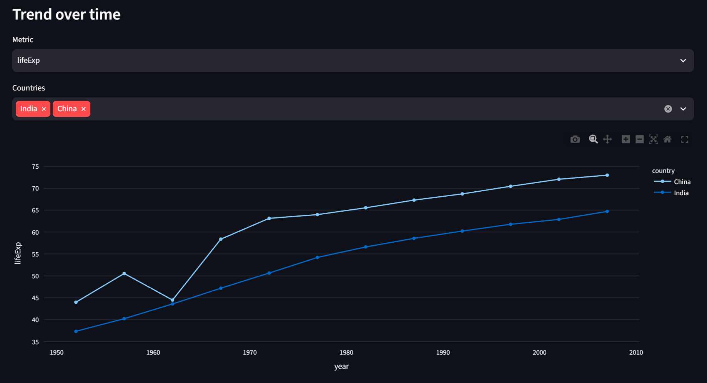
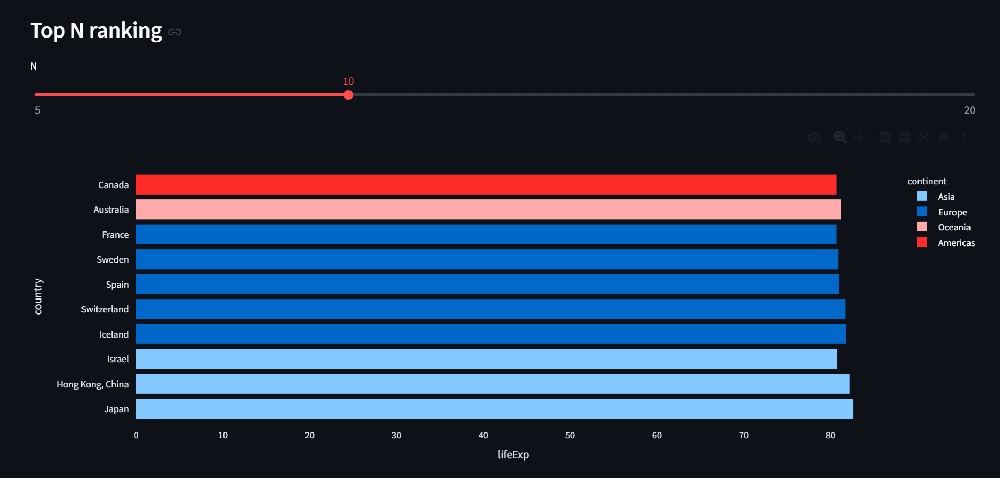
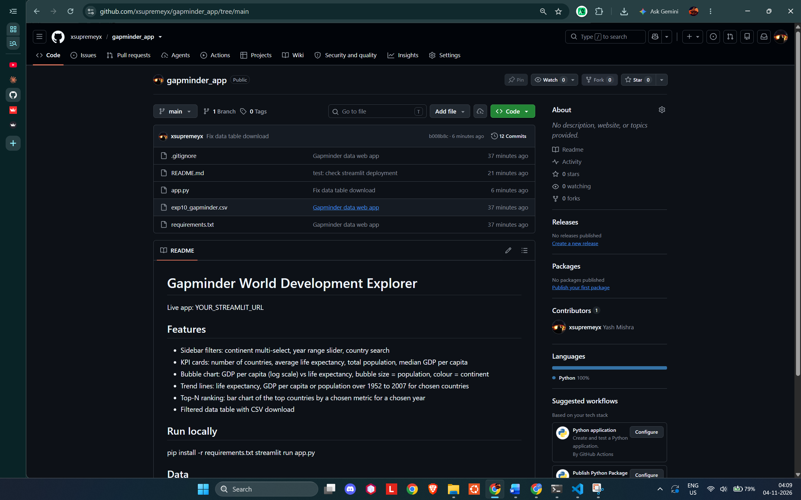

# Gapminder World Development Explorer

Live app: [GapMinder App](https://gapminderapp-xsupremeyx.streamlit.app/)

## Features
- Sidebar filters: continent multi-select, year range slider, country search
- KPI cards: number of countries, average life expectancy, total population, median GDP per capita
- Bubble chart: GDP per capita (log scale) vs life expectancy, bubble size = population, colour = continent
- Trend lines: life expectancy, GDP per capita or population over 1952 to 2007 for chosen countries
- Top-N ranking: bar chart of the top countries by a chosen metric for a chosen year
- Filtered data table with CSV download

## Screenshots

## Run locally
pip install -r requirements.txt
streamlit run app.py

## Data
Gapminder Foundation, via github.com/plotly/datasets (gapminderDataFiveYear.csv).